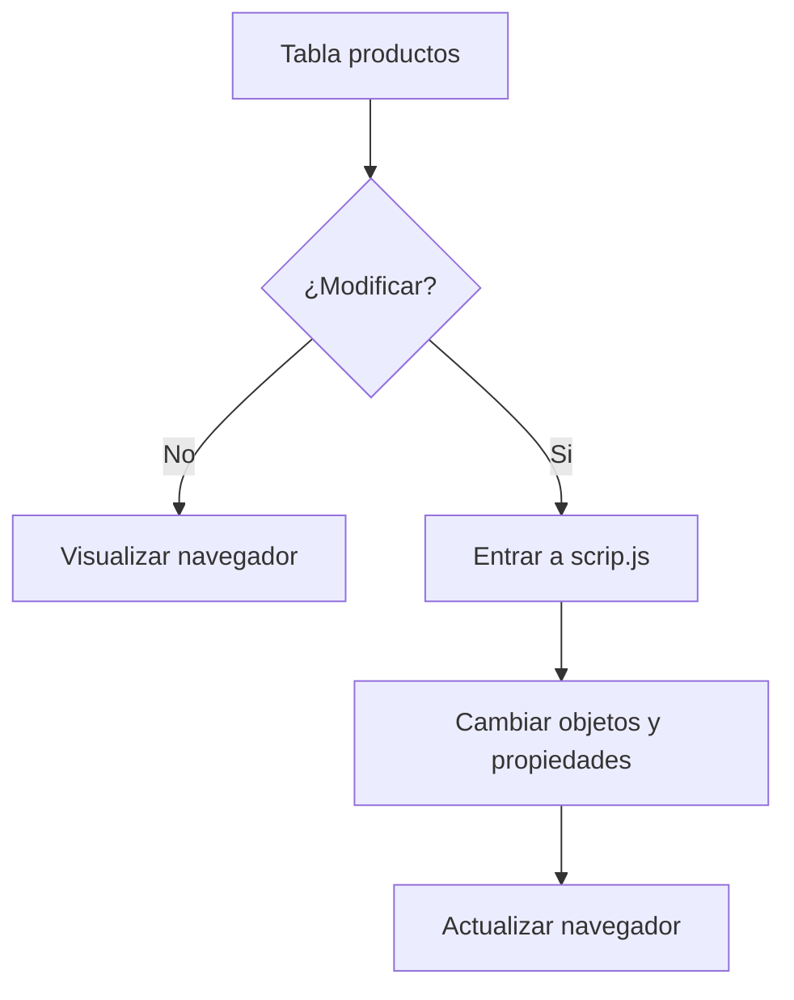

# Tienda TECSUP


Aplicación web que muestra el monto total de una lista de productos de la marca **Tecsup**.

Pensada para que los estudiantes puedan modificar el resultado dentro del archivo `script.js`.

## Tabla de contenidos

- [Instalación](#instalación)
- [Uso](#uso)
- [Ejemplos de codigo](#ejemplos-de-codigo)
- [Estado de funciones](#estado-de-funciones)
- [Hoja de ruta](#hoja-de-ruta)
- [Flujo para modificar la tabla](#flujo-para-modificar-la-tabla)
- [Contribución](#contribución)
- [Autor](#autor)

## Instalación

```bash
git clone https://github.com/TU-USUARIO/app-notas.git
cd app-notas
code .
```

## Uso

1. Entrar al archivo `script.js` dentro del repositorio **tienda-tecsup**.
2. Cambiar los valores de los objetos y sus propiedades dentro de la constante `productos`.
3. `Ctrl + S` para guardar los cambios.
4. Abrir el archivo `index.html` en el navegador.
5. Visualizar el resultado.

## Ejemplos de codigo

Estructura de la tabla:

```html
<table>
    <tr><th>Producto</th><th>Precio</th><th>Cantidad</th></tr>
    <tr><td>Polo TECSUP</td><td>S/ 25.00</td><td>2</td></tr>
    <tr><td>Taza TECSUP</td><td>S/ 18.00</td><td>1</td></tr>
  </table>
  ```

Estructura de la constante `productos`:

```js
const productos = [
  { nombre: "Polo TECSUP", precio: 25.00, cantidad: 2 },
  { nombre: "Taza TECSUP", precio: 18.00, cantidad: 1 }
];
```

## Estado de funciones

| Función | Estado | Prioridad |
|:--------|:------:|----------:|
| Agregar productos | En curso | Alta |
| Modificar precio | Pendiente | Media |
| Modificar cantidad | Pendiente | Media |


## Hoja de ruta

- [x] Diseño de la pantalla
- [x] Diseño de tabla
- [ ] Modificar tabla
- [ ] Opción para imprimir

## Flujo para modificar la tabla



## Contribución

Lee la [guia de contribucion](CONTRIBUTING.md) antes de enviar cambios.

## Autor

Hecho por **LuisMezaCH** - [GitHub](https://github.com/TU-USUARIO)